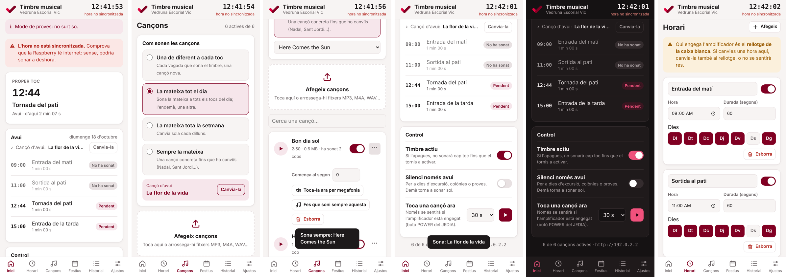

# Timbre musical · Vedruna Escorial Vic

Substitueix el reproductor USB d'una sola cançó de la megafonia de l'escola per una **Raspberry Pi 3** que toca cançons diferents a les hores d'entrada i de pati. Tot es gestiona des d'una **web en català** (mòbil i ordinador): horari, cançons, festius, historial i ajustos.

- **Instal·lar a la Raspberry:** [GUIA.md](GUIA.md)
- **Context complet per a Claude Code / desenvolupament:** [CLAUDE.md](CLAUDE.md)
- **Provar la web a l'ordinador (sense so):** `bash tools/demo.sh` → http://localhost:8099

## Fitxers

| Fitxer | Què és |
|---|---|
| `timbre.py` | Tot el programa: programador d'horari + reproductor (mpv) + web/API (Flask) |
| `web/index.html` | La web (HTML + CSS + JS sense frameworks) |
| `installa.sh` | Instal·lador per a la Raspberry (paquets, servei systemd) |
| `GUIA.md` | Guia pas a pas per instal·lar-ho a l'escola |
| `tools/` | Mode demo, proves de l'API i captures automàtiques |
| `docs/fotos/` | Fotos de l'equip de megafonia real |
| `versions-anteriors/` | Versions descartades (per context) |
